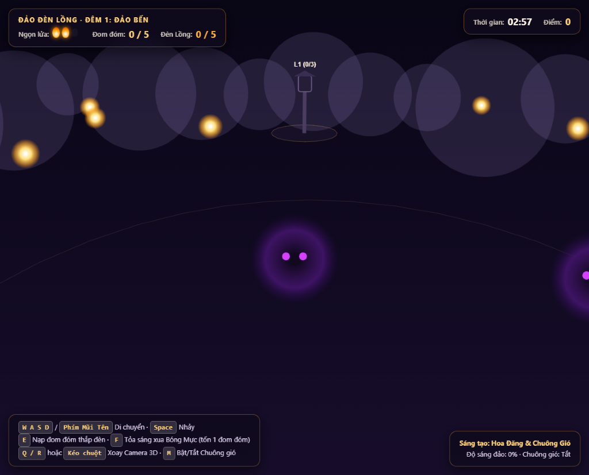

# Đảo Đèn Lồng — v1.0.0 (Day 12 AI SDLC Lab)

> **Học viên:** Phạm Nguyên Vũ · **MSSV:** `2A202603436` · **Lớp:** K5-L3A
> **Video Demo (`.mp4`):** [Xem Video Demo tại Release `v1.0.0` / `docs/demo/demo.mp4`](docs/demo/demo.mp4)



**Đảo Đèn Lồng** là game 3D góc nhìn thứ ba qua 3 Đêm (**Đảo Bến**, **Đảo Cau**, **Đảo Chuông**). Người chơi điều khiển **Mây** — người giữ đèn nhỏ tuổi đội nón lá treo đèn lồng nhỏ — thu thập đom đóm, thắp sáng và giữ dầu cho các Đèn Lồng Lớn tới bình minh, đồng thời đối phó với **Bóng Mực**, **Gió Lạc** và gió bão.

---

## 1. Yêu cầu Hệ thống & Cài đặt (Tối đa 3 lệnh — macOS / Linux / Windows)

- **Yêu cầu:** Node.js `>= 18` (Zero external npm dependencies — không cần cài thư viện ngoài) và trình duyệt web hiện đại.

```bash
# Lệnh 1: Kiểm tra build / cú pháp
node --check src/headless.js

# Lệnh 2: Chạy toàn bộ Unit Test, Regression & Contract v1.3
node tests/run_tests.js

# Lệnh 3: Khởi động game 3D (mở http://localhost:3000 trên trình duyệt)
node src/server.js
```

---

## 2. Điều khiển Mặc định (Hỗ trợ Đổi Phím trong Cài đặt)

| Phím / Chuột | Hành động |
|---|---|
| `W A S D` hoặc `Phím Mũi Tên` | Di chuyển Mây trên đảo theo hướng Camera 3D |
| `Space` | Nhảy (Jump) |
| `Shift` | **Lướt (Dash)** (`14 m/s`, `0.2s`, hồi chiêu `1.5s`; vô hạn hồi chiêu khi có Bùa Gió) |
| `E` | Nạp đom đóm thắp đèn (`10` lần đầu, `5` thắp lại) hoặc **châm dầu** cho đèn đang sáng |
| `F` | **Tỏa Sáng (Pulse)**: tốn `3` đom đóm, làm choáng (`2s`) & đẩy lùi Bóng Mực (`4m`), phá Gió Lạc |
| `Q / R` hoặc `Kéo chuột trái` | Xoay Camera 3D |
| `Esc / P` | Tạm dừng (Pause Menu) |

---

## 3. Chế độ Headless, Benchmark, Soak & Bảng Xếp Hạng (Contract v1.3)

Khai báo chuẩn tại [`game.contract.json`](game.contract.json):

```bash
# Headless simulation (60Hz tất định, hỗ trợ --night 1|2|3)
node src/headless.js --seed 42 --night 1 --ticks 14400 --out tests/.tmp/out.jsonl --snapshot-every 60

# Benchmark 30 giây (xuất bench.json)
node src/bench.js --seed 42 --duration 30 --out bench.json

# Soak test 10 Đêm liên tiếp (xuất soak.json)
node src/soak.js --seed 7 --nights 10 --out soak.json

# Xuất Bảng xếp hạng cục bộ
node src/server.js --export-leaderboard leaderboard_export.json
```

---

## 4. Sáng tạo của tôi (Creative Additions — Hạng mục F)

Tất cả yếu tố sáng tạo được tách biệt hoàn toàn trong tầng hiển thị [`src/web/game3d.js`](src/web/game3d.js) (tắt khi chạy headless/bench/soak, không ảnh hưởng đầu ra Test Contract):
1. **Hoa Đăng bay lên trời & Bầu trời chuyển ấm** theo tỷ lệ ánh sáng trên đảo (`0% -> 100%`).
2. **Chuông Gió Ngũ Cung Việt Nam** tổng hợp thời gian thực bằng Web Audio API.
3. **Giao diện Dark Glassmorphism & WCAG Accessibility** thiết kế bằng skill [`ui-ux-pro-max`](.agents/skills/ui-ux-pro-max/SKILL.md) ([`design-system/dao-den-long/MASTER.md`](design-system/dao-den-long/MASTER.md)).

---

## 5. Hồ sơ SDLC, Harness AI, Bằng chứng & Tài liệu

- **Harness AI:** [`AGENTS.md`](AGENTS.md), [`.agents/skills/verify-contract/SKILL.md`](.agents/skills/verify-contract/SKILL.md), [`.agents/skills/ui-ux-pro-max/SKILL.md`](.agents/skills/ui-ux-pro-max/SKILL.md), [`.githooks/pre-commit`](.githooks/pre-commit), [`.github/workflows/verify.yml`](.github/workflows/verify.yml).
- **Ghi chép & Retro:** [`docs/notes/phase-1-notes.md`](docs/notes/phase-1-notes.md), [`docs/notes/phase-2-notes.md`](docs/notes/phase-2-notes.md), [`docs/notes/phase-3-adr.md`](docs/notes/phase-3-adr.md), [`docs/notes/retro.md`](docs/notes/retro.md).
- **Bằng chứng & Số đo:** [`docs/proof/phase-1/PROOF.md`](docs/proof/phase-1/PROOF.md), [`docs/proof/phase-2/PROOF.md`](docs/proof/phase-2/PROOF.md), [`docs/proof/phase-3/PROOF.md`](docs/proof/phase-3/PROOF.md), [`docs/proof/phase-4/PROOF.md`](docs/proof/phase-4/PROOF.md), [`bench.json`](bench.json), [`soak.json`](soak.json).
- **Phát hành & Bản quyền:** [`CHANGELOG.md`](CHANGELOG.md), [`CREDITS.md`](CREDITS.md), [`LICENSE`](LICENSE).
